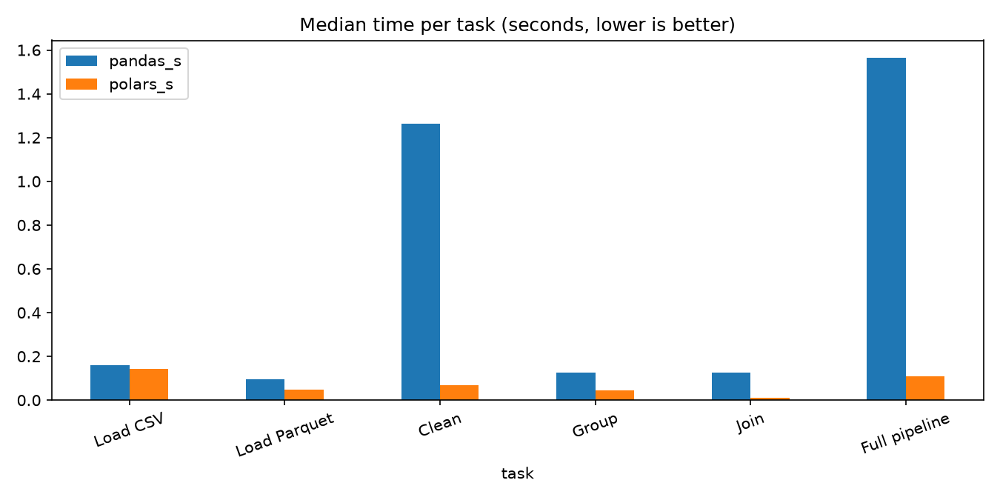
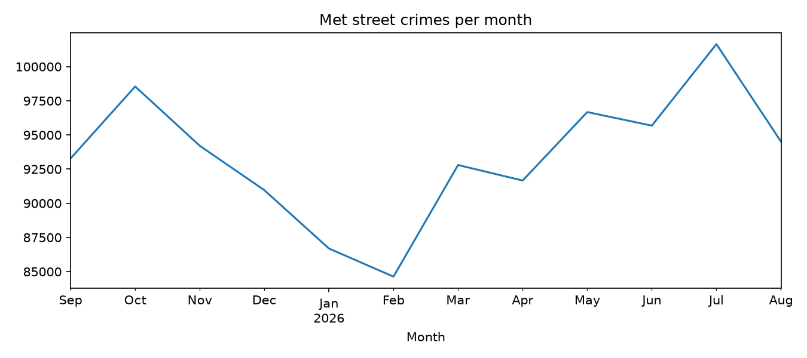
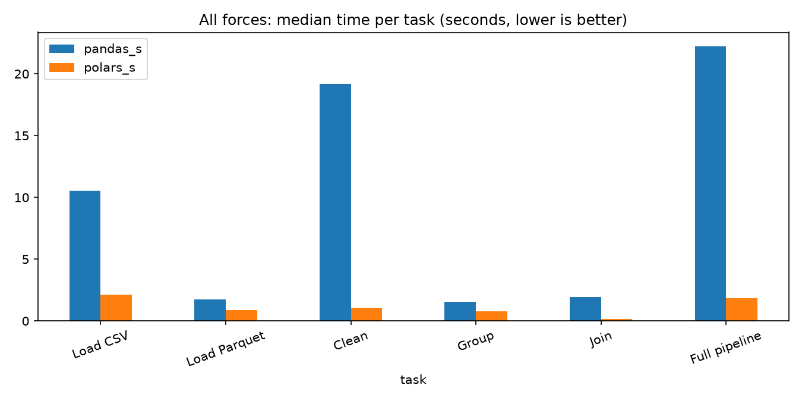

# pandas vs Polars on Metropolitan Police crime data

How much faster is Polars than pandas on a real, million-row UK dataset? I ran the same data pipeline in both libraries and timed every step.

## The data

- **Source:** [data.police.uk](https://data.police.uk/data/), street-level crime
- **Force:** Metropolitan Police. I first planned to use Greater Manchester Police, but GMP doesn't publish to data.police.uk, so I switched to the Met, which is also the largest dataset.
- **Period:** September 2025 to August 2026 (12 monthly files)
- **Size:** 1,121,303 rows, about 252 MB as CSV

The data isn't stored in this repo. To rerun the project, download the Met street-crime files for those months into `data/raw/`.

## Method

- **Setup:** Python 3.13, pandas 3.1.0, Polars 2.1.0, pyarrow 26.0.0
- **Computer:** AMD Ryzen 5 5600G (6 cores), 32 GB RAM, Windows
- **Tasks:** both libraries ran exactly the same steps:
  - **Load:** read the combined CSV and a Parquet copy
  - **Clean:** drop the empty column, parse the month as a date, and take the borough from the area (LSOA) name
  - **Group:** count crimes by borough and crime type
  - **Join:** add a broad category (Violent, Property, Public order or Other) from a small lookup table I made
  - **Full pipeline:** all of the above in one go, plus Polars' "lazy" mode, which plans the whole job before running it
- **Timing:** every task ran 5 times and I kept the median.

## Results

| Task | pandas | Polars | Polars faster by |
|---|---|---|---|
| Load the CSV | 0.161s | 0.144s | 1.1× |
| Load Parquet | 0.096s | 0.049s | 2.0× |
| Clean | 1.263s | 0.068s | 18.5× |
| Group | 0.126s | 0.045s | 2.8× |
| Join | 0.127s | 0.010s | 12.7× |
| Full pipeline | 1.566s | 0.110s | 14.2× |
| Full pipeline, Polars lazy mode | n/a | 0.034s | about 46× |





I also checked whether pandas was quietly using its faster pyarrow CSV reader. It wasn't: the classic reader (0.167s) and the pyarrow reader (0.194s) took about the same time, so pandas 3.1's own CSV reader really is fast.

## What I found

- **I didn't expect Polars to be this much faster.** Over the full pipeline it was 14 times faster, and about 46 times faster in lazy mode.
- **Loading is close, but cleaning isn't.** Loading the CSV was nearly a tie. The biggest gap came in the cleaning step, which is mostly text work. Polars handles text in fast compiled code and spreads the work across CPU cores, while pandas does more of it step by step.
- **Pandas still feels more familiar.** I've only used pandas before, so its code was easier for me to read and write. Familiarity counts for a lot on small projects.
- **What I'd choose:** the bigger the data gets, the more Polars looks like the better option. For small datasets, pandas is still fine.

## Scaling up: every force, every month

To see whether the gap grows with the data, I reran the same tasks on all the street-crime data on data.police.uk: 44 forces from September 2023 to August 2026. That's 17,834,804 rows, about 3.8 GB as CSV. Because the data is so much bigger, each task ran 3 times and I kept the median.

| Task | pandas | Polars | Polars faster by | Met only (1.1M rows) |
|---|---|---|---|---|
| Load the CSV | 10.53s | 2.14s | 4.9× | 1.1× |
| Load Parquet | 1.75s | 0.87s | 2.0× | 2.0× |
| Clean | 19.18s | 1.09s | 17.7× | 18.5× |
| Group | 1.57s | 0.79s | 2.0× | 2.8× |
| Join | 1.93s | 0.14s | 14.0× | 12.7× |
| Full pipeline | 22.24s | 1.85s | 12.0× | 14.2× |
| Full pipeline, Polars lazy mode | n/a | 0.41s | about 55× | about 46× |



- **Loading the CSV is where the gap grew.** It went from almost a tie to nearly 5× as the file grew to 3.8 GB.
- **Most other tasks kept roughly the same ratio.** The size of the speed-up mostly held, but in real time it matters much more: about 22 seconds a run with pandas against under 2 seconds with Polars.
- This supports my conclusion that Polars makes more sense as the data gets bigger. Mostly that's because the time saved adds up, not because the ratio keeps growing.

To rerun it, download every force's street files into `data/raw_all/` and run `python benchmark_all.py`.

## Limits

- It's one dataset from one police force, grouped in one way (my own categories), so other data or tasks could give different results.
- I ran it on one computer. Faster or slower processors, or less memory, would change the times.
- The timings are medians of only 5 runs, and everything takes under 2 seconds, so small changes in the times can matter a lot.
- My pandas code isn't fully optimised. An experienced pandas user might close part of the gap.

## Run it yourself

```
py -3.13 -m venv .venv
.venv\Scripts\pip install -r requirements.txt
.venv\Scripts\jupyter-lab notebooks/benchmark.ipynb
```

